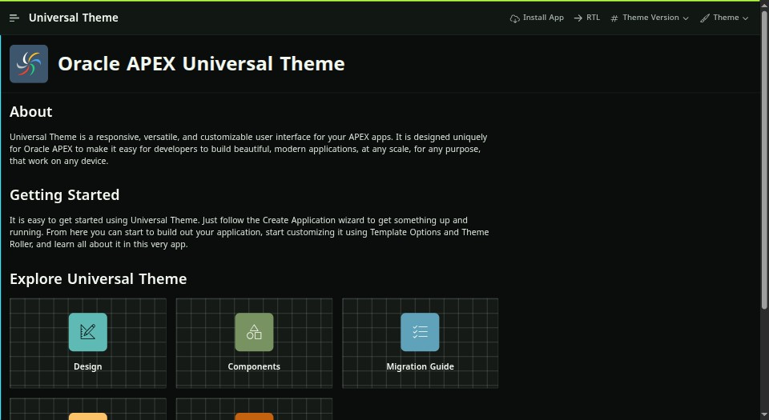
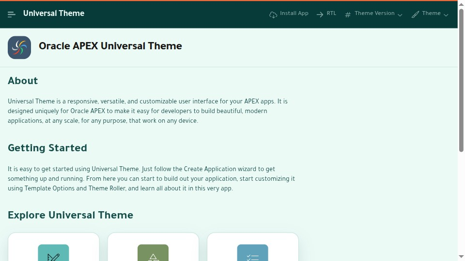
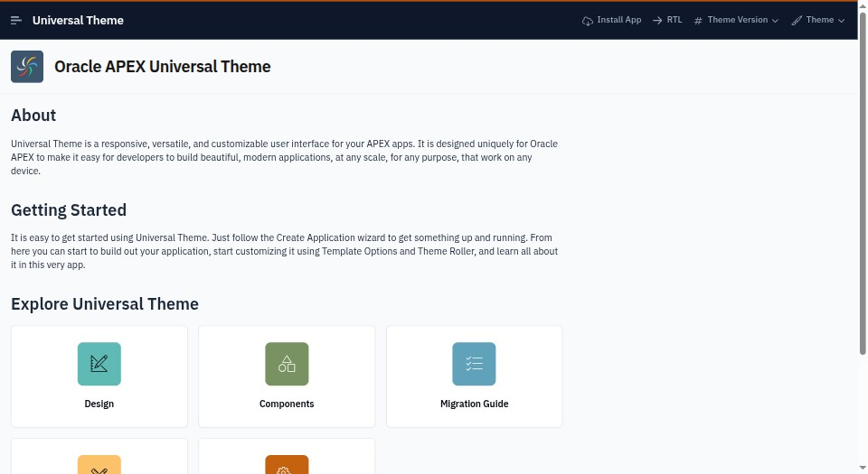
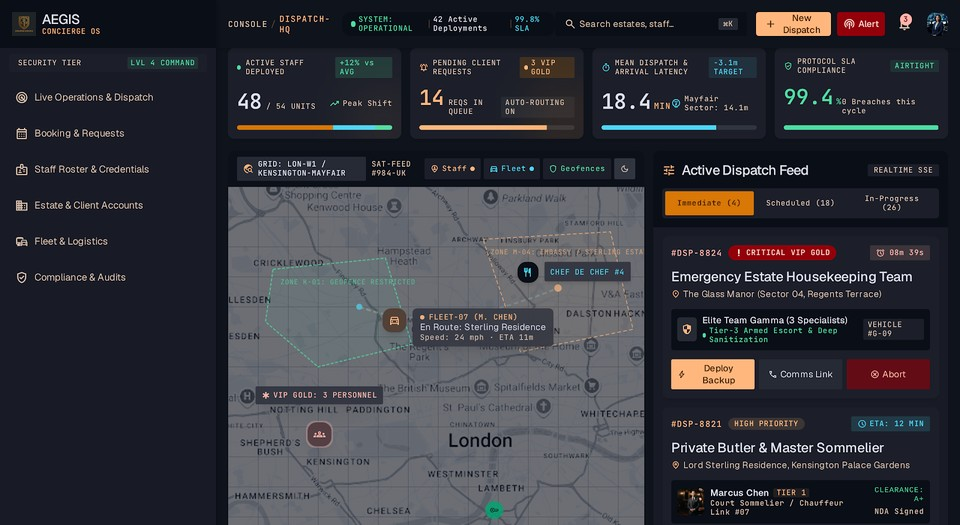
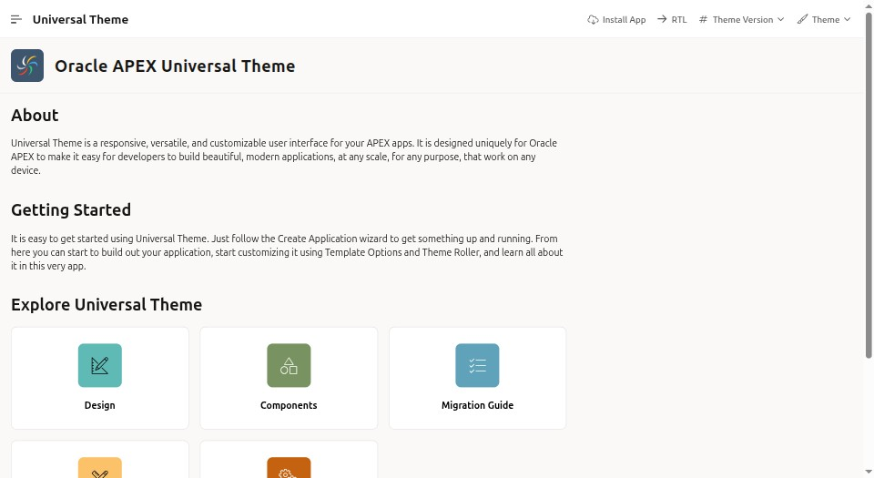
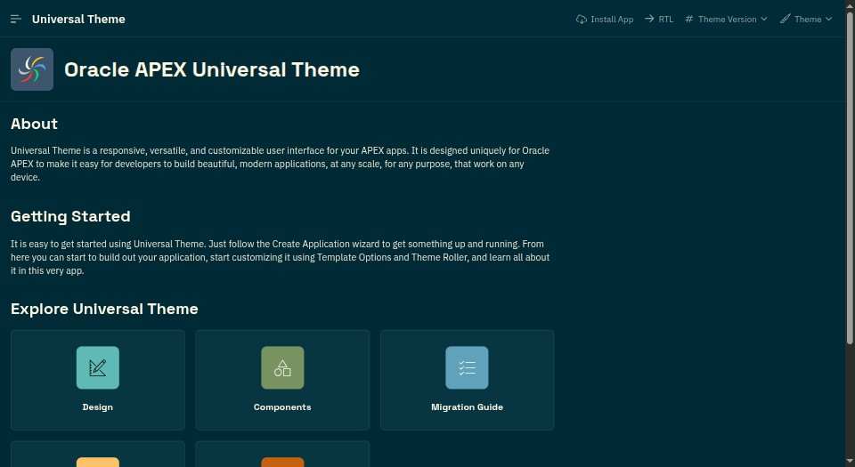
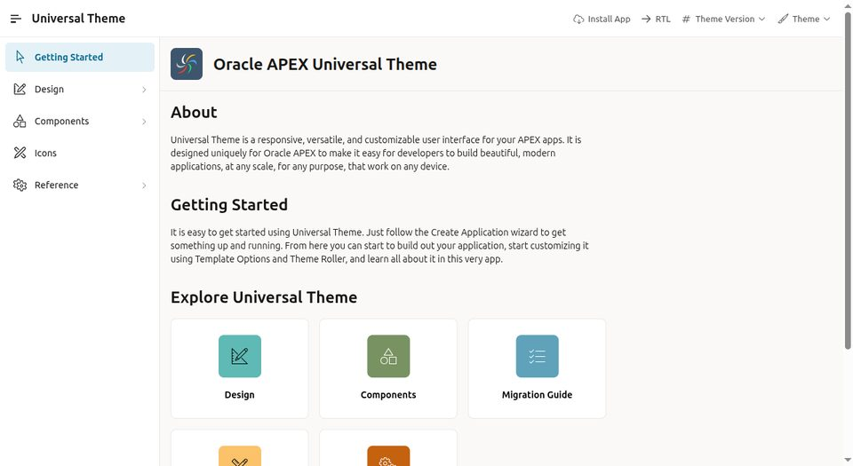

# APEX Theme Factory

Change how an Oracle APEX app looks, without changing the app itself.

This project builds **themes** for Oracle APEX. A theme is a small CSS package. You install it into an APEX app
with one command. Your pages, regions and business logic stay the same. If you remove the theme, the app goes
back to the standard Universal Theme look.

## Which APEX version do I need?

| APEX version | Status |
|---|---|
| 26.1.x | Supported |
| 26.2.x | Supported |

Both versions use **Universal Theme 42** with the **Iris** style. Iris is the only style these themes support.
New apps on APEX 26.1 or later already use it. An app from an older APEX version needs a theme refresh first:
see [Is my app ready?](docs/GET_STARTED.md#is-my-app-ready)

The installer checks all of this first, and it stops when the app is not supported.

## Start here

| I want to… | Read this |
|---|---|
| Install a theme in my APEX app (start here if you are new) | [Get started](docs/GET_STARTED.md) |
| Remove a theme, or undo an install | [Undo an install](docs/GET_STARTED.md#undo-an-install-restore) |
| Put a live demo of all the themes on public APEX hosting | [Put the demo online](docs/PUBLIC_DEMO.md) |
| Build my own theme | [Building and releasing a theme](docs/BUILDING_A_THEME.md) |
| Release a theme | [Releasing a theme](docs/BUILDING_A_THEME.md#releasing-a-theme) |

## Quick start

It works on Windows, macOS and Linux. You need an APEX app, a saved SQLcl connection, Python 3.10 or newer, and a theme package from the
[Releases page](https://github.com/ash2osh/APEX_THEME_FACTORY/releases). The
[Get started guide](docs/GET_STARTED.md) explains each step.

1. **Check your APEX version.** Run this in SQL:

   ```sql
   select version_no from apex_release;
   ```

2. **Preview the install.** This changes nothing:

   ```bash
   ./install.sh --connection <CONNECTION> --workspace <WORKSPACE> --app-id <APP_ID>
   ```

3. **Install for real.** You type the app ID to confirm:

   ```bash
   ./install.sh --connection <CONNECTION> --workspace <WORKSPACE> --app-id <APP_ID> --apply
   ```

In Windows PowerShell, run `powershell -ExecutionPolicy Bypass -File .\install.ps1` with the same options.

`install.sh` and `install.ps1` come inside each theme package. The [Get started guide](docs/GET_STARTED.md) also shows how to build
one from this repository, and how to install by hand in App Builder.

## Safe by design

- **Preview first.** The installer does nothing until you add `--apply`.
- **Backup first.** Before it changes anything, it saves your app's source.
- **Only its own items.** It adds its own files and regions, and it never edits your pages, processes or items.
  It also sets the navigation menu style, and it puts that back when you remove the last theme.
- **Easy undo.** You can remove the theme, or restore the backup.

**An install ends every active session of the app**, because APEX imports the whole app in one step. Private saved
reports and role assignments stay. **A translated app is refused**, because an import would erase its translated text:
install those by hand. Read
[Before you install on a shared or production app](docs/GET_STARTED.md#before-you-install-on-a-shared-or-production-app).

## The eight themes

|   |   |
|---|---|
| [](sample-themes/carbon-volt/) | [](sample-themes/citrus-pop/) |
| **Carbon Volt** (Dark) | **Citrus Pop** (Light) |
| [](sample-themes/cobalt-press/) | [](sample-themes/estate-slate/) |
| **Cobalt Press** (Light) | **Estate Slate** (Light) |
| [](sample-themes/estate-slate-dark/) | [](sample-themes/linen/) |
| **Estate Slate Dark** (Dark) | **Linen** (Light) |
| [](sample-themes/solarized-dark/) | [](sample-themes/velvet-signal/) |
| **Solarized Dark** (Dark) | **Velvet Signal** (Dark) |

Five of the themes bundle Arabic-capable fonts.

## What was tested

Before this release, the project was checked like this:

- **Every page of the reference app:** 123 pages in all eight themes on APEX 26.1 and 26.2, at desktop and phone width, for WCAG AA text contrast, layout overflow and console errors, with stock Iris as the control.
- **Real installs:** install, upgrade, uninstall and restore against a real database.
- **Right-to-left:** a 14-page sample in all eight themes, using the reference app's own RTL switch. It wasn't tested with a fully translated Arabic app.

## Known issues

These happen with stock Iris too, so they aren't theme defects. You see them only if you browse the reference app.

| Where | What happens |
|---|---|
| Sample data on a clean install | Pages that query the `EBA_UT_*` sample tables (for example 1410, 1411, 1412, 1710, 1720, 1908, 3001 and 3110) show ORA-00942 when the tables are missing. |
| Dialog pages 1111, 1112 and 1912–1922 | Opened directly, they show APEX's dialog-template error. |
| Palette page 6302 | Palette colours used as text fail AA. Only a change to the palette itself could fix that. |
| Page 3110 | Automated contrast checks flag card titles over images. This is a false alarm: the check can't see the image. |
| Map page 1906 | The map needs internet access for its tiles. |

Printing a dark theme uses a lot of ink: it prints with its dark background, so the text stays readable.

The 26.2 copy of the reference app was moved to base theme `ut-26.2` by hand. The source here stays on `ut-26.1`,
which imports and runs on both versions. This affects only people working on the reference app.

## For developers

```bash
tests/run-offline.sh    # offline checks; ends with OFFLINE status=PASS
```

Live checks need a database and a browser. See [Releasing a theme](docs/BUILDING_A_THEME.md#releasing-a-theme).
To contribute, read [CONTRIBUTING.md](CONTRIBUTING.md). To report a security problem, read [SECURITY.md](SECURITY.md).
Changes are listed in [CHANGELOG.md](CHANGELOG.md).

## License

MIT. See [LICENSE](LICENSE). Third-party material keeps its own terms: see [NOTICE.md](NOTICE.md).

The reference app in `applications/ut/` is based on Oracle's sample app, which Oracle publishes under the Universal
Permissive License 1.0. Oracle's Universal Theme runtime files are not redistributed:
`scripts/fetch-vendor.sh --reference` copies them from your own APEX instance.
