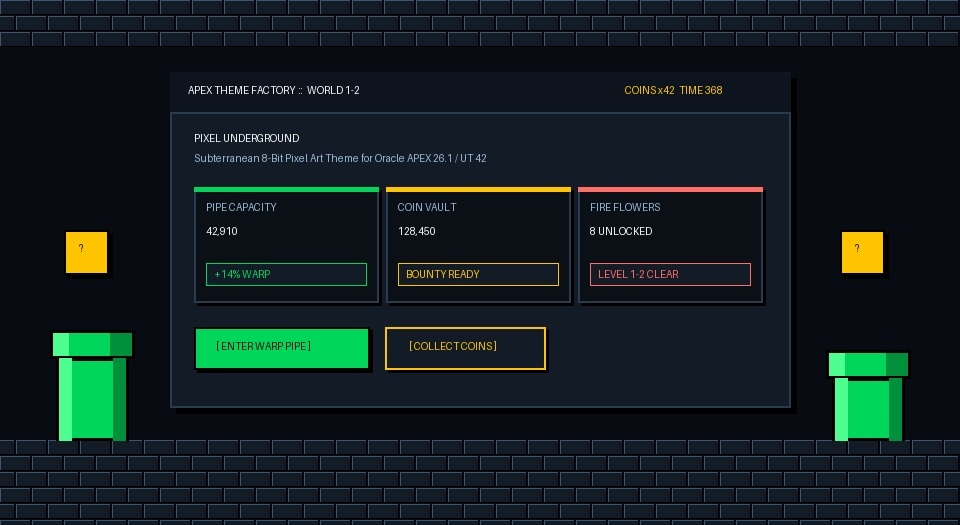

# Coin Cavern — an 8-bit arcade subterranean theme for Universal Theme / Iris

*Subterranean 8-bit stone blocks, iconic warp pipes, and shining coin gold directives.*

| | |
|---|---|
| Base | APEX 26.1.x or 26.2.x · Universal Theme 42 · theme style **Iris** (unchanged) |
| Direction | Dark retro arcade underground inspired by World 1-2: `#080C12` deep cavern canvas, `#131B26` subterranean stone brick blocks, warp pipe green `#00D659` for primary actions, spinning coin gold `#FFC400` for markers and focus |
| Palette | Subterranean slate, warp green, coin gold, fireball red |
| Scope | app-wide, one CSS layer scoped under `html.app-theme-coin-cavern` |

## Preview



## What's inside

```text
theme.json               manifest: name, title, tagline, direction, class, declarative template options
theme.recipe.json        strict schemaVersion 2 recipe with palette, geometry, and component profiles
css/theme.css            entry, loaded by static-files/css/app.css (@themes block, generated)
css/tokens.css           --coin-* palette, --app-* deltas, --ut-* and --a-* remaps on body.apex-theme-iris
css/apex/
  shell.css              cavern header (#0D141E) · retro navigation rail · title bar · footer
  regions.css            stone block cards · 0px radius · hard 4px offset pixel shadow · metric cards
  buttons.css            warp pipe green hot buttons · stone brick default buttons · 0px radius
  forms.css              recessed stone inputs · coin-gold focus ring · 2px pixel borders
  reports.css            ruled data rows · subterranean slate headers · 8-bit styled pagination
  dialogs.css            arcade dialogue frames · 6px hard offset drop shadow
  misc.css               badges (coin gold, pipe green, fireball red) · status pills · alerts
  responsive.css         compact controls at <=768px (generated from recipe)
preview/
  cover.jpg              960 px gallery image
```

## Palette & Contrast (WCAG 2.1 AA)

All core colors audited and verified for high legibility on dark surfaces:

| Role | Colour | On Card `#131B26` | On Canvas `#080C12` | WCAG AA Ratio |
|---|---|---|---|---|
| titles, emphasized text (`--app-text-emphasized`) | Arcade HUD White `#F5F9FC` | 16.36:1 | 18.51:1 | Pass (>= 4.5:1) |
| body text (`--app-text-primary`) | Ice Stone White `#E6EEF8` | 14.80:1 | 16.74:1 | Pass (>= 4.5:1) |
| labels, muted text (`--app-text-secondary`) | Subterranean Slate `#98B8D4` | 8.36:1 | 9.46:1 | Pass (>= 4.5:1) |
| primary action fill (`--app-color-primary`) | Warp Pipe Green `#00D659` | 10.04:1 (with dark ink) | - | Pass (>= 4.5:1) |
| alt accent, focus (`--app-color-warning`) | Coin Gold `#FFC400` | 12.27:1 (with dark ink) | 10.84:1 (border) | Pass (>= 3.0:1) |
| danger / validation (`--app-color-danger`) | Fireball Red `#FF6E67` | 6.33:1 | 7.16:1 | Pass (>= 4.5:1) |
| dark ink on accent fills (`--app-text-on-accent`) | Cavern Ink `#080C12` | 10.04:1 / 12.27:1 | - | Pass (>= 4.5:1) |

## Use this theme

```bash
scripts/apply-theme.sh coin-cavern # make it the app default
scripts/sync-static.sh             # assemble static-files into APEX export
```

Switch live in the browser via the navigation bar **Theme** menu, page 405 *Themes*, URL hash `#theme=coin-cavern`, or in DevTools:

```javascript
ApexThemeFactory.use('coin-cavern')
```
